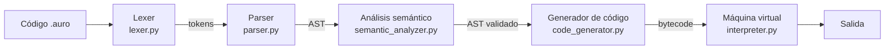

# Aurum

> Un lenguaje de programación pequeño, con tipado estático, hecho desde cero en Python: lexer, parser, análisis semántico, generación de bytecode y una máquina virtual de pila, más un IDE de escritorio.


```aurum
func main() -> void {
    for (int i = 1; i <= 6; i = i + 1) {
        print(i + "! = " + factorial(i))
    }
}

func factorial(int n) -> int {
    if (n <= 1) {
        return 1
    }
    return n * factorial(n - 1)
}
```

```text
$ python run.py examples/factorial.auro
1! = 1
2! = 2
3! = 6
4! = 24
5! = 120
6! = 720
```

---

## Tabla de contenido

- [Qué es](#qué-es)
- [Cómo ejecutarlo](#cómo-ejecutarlo)
- [Arquitectura del compilador](#arquitectura-del-compilador)
- [El lenguaje](#el-lenguaje)
- [La máquina virtual](#la-máquina-virtual)
- [Estructura del proyecto](#estructura-del-proyecto)
- [Pruebas](#pruebas)
- [Lo que aprendí](#lo-que-aprendí)

---

## Qué es

Aurum es un proyecto para entender **cómo funciona un compilador por dentro**. El código fuente pasa por todas las fases clásicas y termina como bytecode, que luego ejecuta una máquina virtual propia. No usa librerías externas (ni generadores de parsers): todo está escrito a mano con la biblioteca estándar de Python.

**Características**

- Tipado estático: `int`, `float`, `string`, `bool`, con chequeo de tipos antes de ejecutar.
- Funciones con parámetros tipados, tipo de retorno y recursión.
- `if` / `elif` / `else`, `while`, `for`, `break` y `continue`.
- Operadores aritméticos, de comparación y lógicos (`and`, `or`, `not`).
- Entrada y salida con `read()`, `print()` y `write()`.
- Mensajes de error con número de línea en cada fase.
- IDE de escritorio (Tkinter) con editor, salida, ayuda de sintaxis y ejemplos.

## Cómo ejecutarlo

Requiere **Python 3.10 o superior**. No hay dependencias que instalar.

```bash
git clone https://github.com/SeguraStward/mylanguage.git
cd mylanguage
```

**Desde la terminal**

```bash
python run.py examples/fizzbuzz.auro
python run.py examples/lectura.auro --input Ana aurum   # valores para read()
python run.py examples/factorial.auro --bytecode         # muestra el bytecode generado
```

**Con el IDE**

```bash
python main.py
```

> El IDE usa Tkinter. En Windows y macOS ya viene con Python; en Linux puede que necesites `sudo apt install python3-tk`.

## Arquitectura del compilador



| Fase | Archivo | Qué hace |
|------|---------|----------|
| Análisis léxico | `src/lexer.py` | Convierte el texto en tokens con expresiones regulares e identifica palabras reservadas. |
| Análisis sintáctico | `src/parser.py` | Parser descendente recursivo que construye el árbol de sintaxis abstracta (AST) respetando la precedencia de operadores. |
| Análisis semántico | `src/semantic_analyzer.py` | Tabla de símbolos con ámbitos, chequeo de tipos, variables no declaradas y llamadas a funciones. |
| Generación de código | `src/code_generator.py` | Recorre el AST y emite instrucciones para una máquina de pila, con etiquetas para saltos. |
| Ejecución | `src/interpreter.py` | Máquina virtual con pila de operandos, memoria y pila de llamadas. |
| Orquestación | `src/compiler.py` | Une las fases y entrega resultados y errores. |
| IDE | `src/ide.py` | Interfaz gráfica para escribir, compilar y ejecutar. |

## El lenguaje

```aurum
// Comentario de una línea
/* Comentario de varias líneas */

func main() -> void {
    int edad = 20
    float precio = 19.99
    string nombre = "Ana"
    bool activo = true

    if (edad >= 18 and activo) {
        print(nombre + " es mayor de edad")
    } elif (edad > 12) {
        print("adolescente")
    } else {
        print("niño")
    }

    int i = 0
    while (i < 3) {
        print("vuelta " + i)
        i = i + 1
    }
}

func suma(int a, int b) -> int {
    return a + b
}
```

Reglas importantes:

- Todo programa empieza en `func main() -> void`.
- No se usa punto y coma al final de las líneas.
- `print()` recibe un `string`. Para imprimir un número, concaténalo: `print("" + n)`.
- `read()` devuelve el siguiente valor de entrada como texto.

Hay más programas en la carpeta [`examples/`](examples).

## La máquina virtual

El generador produce instrucciones para una **máquina de pila**. Por ejemplo, `int x = a + 2` se traduce a:

```text
LOAD 0         ; apila el valor de a
LOAD_CONST 2   ; apila la constante 2
ADD            ; saca ambos y apila la suma
STORE 1        ; guarda el resultado en x
```

| Grupo | Instrucciones |
|-------|---------------|
| Memoria | `LOAD_CONST`, `LOAD`, `STORE`, `STORE_PARAM` |
| Aritmética | `ADD`, `SUB`, `MUL`, `DIV`, `MOD`, `NEG` |
| Comparación | `EQ`, `NEQ`, `LT`, `GT`, `LEQ`, `GEQ` |
| Lógica | `AND`, `OR`, `NOT` |
| Control | `JUMP`, `JUMP_IF_FALSE`, `LABEL`, `HALT` |
| Funciones | `CALL`, `RETURN`, `RETURN_VALUE`, `ENTER`, `LEAVE` |
| Pila | `POP` |

En [`docs/tutorial/`](docs/tutorial) hay dos scripts que explican paso a paso cómo se diseñó la máquina virtual y cómo se traduce cada nodo del AST a bytecode.

## Estructura del proyecto

```text
mylanguage/
├── main.py                 # abre el IDE
├── run.py                  # ejecuta un archivo .auro desde la terminal
├── src/
│   ├── lexer.py
│   ├── parser.py
│   ├── semantic_analyzer.py
│   ├── code_generator.py
│   ├── interpreter.py
│   ├── compiler.py
│   └── ide.py
├── examples/               # programas de ejemplo en Aurum
├── tests/                  # pruebas de extremo a extremo
└── docs/tutorial/          # explicación del diseño de la VM y del bytecode
```

## Pruebas

```bash
python -m unittest discover tests
```

Las pruebas compilan y ejecutan los programas de `examples/` y verifican que los errores de tipos, de sintaxis y de variables no declaradas se detecten antes de ejecutar.

## Lo que aprendí

- Cómo se separa un compilador en fases y qué información pasa de una a otra.
- Escribir un parser descendente recursivo y manejar la precedencia de operadores.
- Implementar una tabla de símbolos con ámbitos anidados para validar tipos.
- Diseñar un conjunto de instrucciones y una máquina virtual de pila, incluyendo llamadas a funciones y recursión.

---

Hecho por **Stward Segura**, estudiante de Ingeniería en Sistemas en la Universidad Nacional de Costa Rica.
